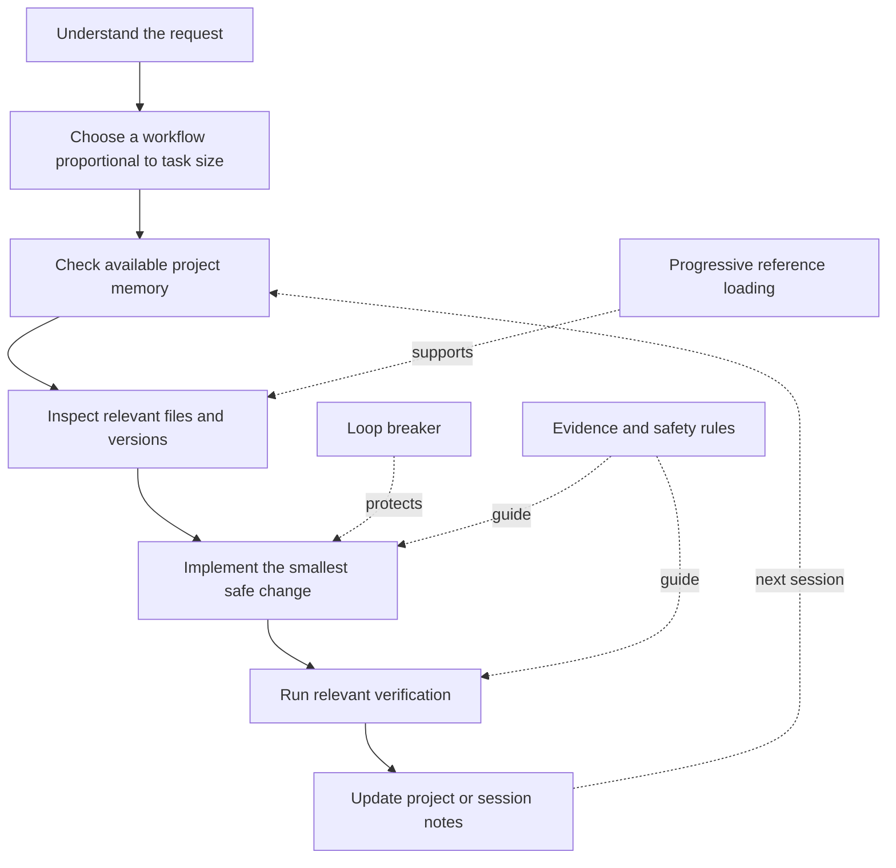

<div align="center">

# Conscious Workflow

### A token-conscious engineering workflow for Claude

**Less repetition. Better context. Evidence-first execution.**

<p>
  <a href="https://github.com/MrKroven/conscious-workflow/releases"></a>
  <a href="https://github.com/MrKroven/conscious-workflow/stargazers"></a>
  
  
  <a href="LICENSE"></a>
</p>

[Quick Start](#quick-start) · [Features](#features) · [How It Works](#how-it-works) · [Usage Examples](#usage-examples) · [Türkçe](README_TR.md)

</div>

---

## What is Conscious Workflow?

**Conscious Workflow** is a modular Skill that gives Claude a more disciplined, context-aware way to handle software engineering work. It is designed for repository analysis, coding, debugging, technical research, refactoring, and multi-step development tasks.

Its central idea is simple: **spend context on useful work, not on repeated work.**

The Skill provides a compact set of core operating rules, then directs Claude to load detailed reference modules only when a task needs them. Optional Python utilities help map a repository, compare file snapshots, maintain lightweight project memory, track repeated errors, and validate the Skill package.

It supports two distinct ways of working:

- **Claude Code** — install it as a filesystem Skill and invoke it with `/conscious-workflow` or let Claude Code select it automatically when relevant.
- **Claude.ai** — upload and enable the Skill in Settings. Claude can use it when relevant, or when you explicitly ask it to.

> [!IMPORTANT]
> Conscious Workflow is an instruction framework, not a new AI model or a guarantee of autonomous execution. Token usage and output quality still depend on the model, task, available tools, and project context. It does not promise a fixed token-reduction percentage.

## Why use it?

| Problem | Conscious Workflow approach |
|---|---|
| Re-reading the same files | Keep concise findings in session notes and inspect only relevant or changed files when possible. |
| Repeating a failed command or fix | Use root-cause analysis, record failed attempts, and change strategy instead of retrying blindly. |
| Losing project context between sessions | Keep stable architecture notes separate from the current task and next-step handoff. |
| Loading too much documentation at once | Use progressive disclosure: load a reference module only when its trigger condition matches. |
| Guessing APIs or library behavior | Check the project's installed versions and prefer official documentation and changelogs. |
| Claiming work is complete without evidence | Run relevant checks and clearly distinguish verified results from assumptions. |
| Overengineering small tasks | Scale planning and documentation to the actual size and risk of the task. |

## Features

### 1. Token-conscious project inspection

Conscious Workflow encourages Claude to understand the task before opening files, inspect the smallest useful section, and avoid repeating unchanged reads without a reason. For larger repositories, the optional project mapper creates a compact file index and records SHA-256-based file snapshots.

This is intended to reduce unnecessary context usage; it does not mean that every task can avoid a repository scan or that every token-heavy operation can be eliminated.

### 2. Loop prevention and root-cause debugging

The Skill applies a three-strike response to recurring failures:

| Attempt | Expected behavior |
|---|---|
| **Strike 1** | Capture the exact error, inspect the relevant code, and test a root-cause hypothesis. |
| **Strike 2** | Stop making near-identical edits. Record what failed and switch to a materially different approach. |
| **Strike 3** | Stop repeating the failing operation. Explain the likely cause, attempted approaches, and the blocker or decision needed. |

The optional `memory_guard.py` utility can record error signatures and enforce its own three-strike counter for a project.

### 3. Persistent project context

The Skill uses two compact memory files for multi-session work:

- `PROJECT_MEMORY.md` — relatively stable information such as the tech stack, architecture, entry points, important files, and permanent decisions.
- `SESSION_STATE.md` — the current objective, progress, files already inspected, known failures, and the next action for a future session.

A third template, `TASK_PROGRESS.md`, is available for larger projects that need explicit phases and acceptance criteria. These are ordinary project files: they persist because they are stored in the repository, not because the Skill has hidden or unlimited memory.

### 4. Research and evidence-first engineering

When a task depends on version-specific APIs, unfamiliar libraries, or changing behavior, the Skill directs Claude to inspect lockfiles and installed packages first, then verify against official documentation and changelogs. It also encourages focused regression checks and honest reporting.

### 5. Proportional execution

Not every request needs a lengthy plan. The Skill scales its process to the work:

- **Small task:** understand, make the focused change, verify it.
- **Standard task:** inspect relevant files, implement, run targeted checks, update session notes.
- **Complex task:** define scope and acceptance criteria, map the project, execute in stages, verify, and save a handoff.

### 6. Optional Python utilities

The bundled scripts are helpers, not mandatory dependencies for using the Skill. They can be run locally when Python and filesystem access are available.

## How it works



### Progressive-disclosure modules

`SKILL.md` is the core router. It does not ask Claude to read every reference file at the start of every task. Instead, it maps a task phase to the relevant module:

| Reference file | Load when the task involves... |
|---|---|
| `references/project-analysis.md` | A new repository, archive, codebase, document, or visual project inspection. |
| `references/memory-system.md` | Starting or resuming a multi-session project, or preserving context. |
| `references/token-optimization.md` | Large files, context-budget decisions, and efficient inspection. |
| `references/loop-prevention.md` | Repeated errors, failed attempts, or retry-loop control. |
| `references/debugging.md` | Root-cause analysis, test failures, and regression verification. |
| `references/research-engine.md` | Unfamiliar APIs, library versions, official documentation, and deprecations. |
| `references/software-engineering.md` | Implementing, refactoring, or reviewing production code. |
| `references/task-execution.md` | Complex planning, execution stages, autonomy, and task handoff. |

## Quick Start

Choose the environment you use. **The slash command is for Claude Code; Claude.ai uses the Skill interface instead.**

### Option A — Claude Code (recommended for `/conscious-workflow`)

#### 1. Install globally

A global installation makes the Skill available across your Claude Code projects.

**Windows PowerShell**

```powershell
git clone https://github.com/MrKroven/conscious-workflow.git "$env:USERPROFILE\.claude\skills\conscious-workflow"
```

**macOS / Linux**

```bash
git clone https://github.com/MrKroven/conscious-workflow.git "$HOME/.claude/skills/conscious-workflow"
```

#### 2. Or install in one project only

For a project-specific Skill, add the repository as a Git submodule from your project's root:

```bash
git submodule add https://github.com/MrKroven/conscious-workflow.git .claude/skills/conscious-workflow
```

When another developer clones your project, they should include submodules:

```bash
git clone --recurse-submodules <your-project-repository>
```

If you do not want to use Git submodules, download the repository ZIP and copy its contents (excluding any `.git` directory) into `.claude/skills/conscious-workflow/`. In either case, `SKILL.md` must be directly inside the `conscious-workflow` directory.

#### 3. Restart or open a new Claude Code session

At the Claude Code prompt, type:

```text
/skills
```

Check that `conscious-workflow` is listed and enabled.

#### 4. Invoke the Skill

The Skill's directory and metadata name are both `conscious-workflow`, so the direct Claude Code command is:

```text
/conscious-workflow
```

For a real task, put the command at the **start** of your message and describe what you want after it:

```text
/conscious-workflow Inspect this repository, explain its architecture, identify its entry points, and create a concise project map. Do not modify files yet.
```

```text
/conscious-workflow Find the root cause of the login bug, implement the smallest safe fix, run the relevant tests, and report exactly what you verified.
```

```text
/conscious-workflow Continue the unfinished task using the existing project memory. Review the next-step handoff first and avoid repeating completed work.
```

> [!TIP]
> You can also describe a relevant coding or engineering task normally and Claude Code may invoke the Skill automatically. Use `/conscious-workflow` when you want to request it explicitly.

**Command behavior:** `/conscious-workflow` is the Skill entry point, not a collection of separate built-in commands. Words such as `debug`, `research`, `audit`, or `implement` after it are task instructions, not registered subcommands.

### Option B — Claude.ai (web or desktop)

Claude.ai does **not** use the `/conscious-workflow` Claude Code command. Upload and enable the Skill instead:

1. Download the `conscious-claude-en.zip` asset from the [Releases](https://github.com/MrKroven/conscious-workflow/releases) page.
2. Open Claude and go to **Settings → Customize → Skills**.
3. Choose **Add / Create skill → Upload a skill** (the exact label may vary with the interface).
4. Upload the ZIP and enable **Conscious Workflow**.
5. Make sure **Code execution** is enabled if you want Claude to use the bundled scripts in an environment where those scripts are available.
6. Start a chat and ask Claude to use the Skill for your task.

Example:

```text
Use the Conscious Workflow skill for this project. First inspect the existing project context, then analyze only the files relevant to my request. Avoid repeating unchanged reads, do not retry an identical failed approach, and verify any code changes before reporting completion.
```

Claude.ai can select enabled Skills automatically when they are relevant. You can also name the Skill explicitly in your message. Do not type `/conscious-workflow` in Claude.ai and expect the Claude Code slash-command behavior.

## Usage examples

These examples are prompts, not separate slash commands. In Claude Code, prefix them with `/conscious-workflow` when you want explicit invocation. In Claude.ai, send them as normal messages after enabling the Skill.

| Goal | Example task |
|---|---|
| Understand a repository | "Map this project, identify its stack and entry points, and explain how the main modules connect. Do not edit anything." |
| Fix a bug | "Reproduce the error, find its root cause, make the smallest safe fix, and run a focused regression check." |
| Add a feature | "Inspect the existing architecture first. Implement this feature consistently with current patterns and update relevant tests." |
| Research an API | "Check the installed package version and official documentation before choosing an API. Flag anything you cannot verify." |
| Resume work | "Read the project memory and session handoff first. Continue from the recorded next step without redoing completed work." |
| Review code | "Review the changed files for correctness, edge cases, security, and missing tests. Report findings with file references." |

## Optional CLI utilities

Python **3.8 or newer** is required for the bundled scripts. The scripts live inside the Skill directory, so call them through that directory when working in a separate project.

The examples below assume a **project-specific installation** at `.claude/skills/conscious-workflow/`. If you installed the Skill globally, replace that prefix with `~/.claude/skills/conscious-workflow/` (or `%USERPROFILE%\.claude\skills\conscious-workflow\` in Windows PowerShell).

### `project_mapper.py` — project map and file snapshots

Run these commands from your target project's root directory. Create a compact project map and save a SHA-256 snapshot:

```bash
python .claude/skills/conscious-workflow/scripts/project_mapper.py . --save-cache
```

Compare the current project with the previous snapshot:

```bash
python .claude/skills/conscious-workflow/scripts/project_mapper.py . --diff
```

The snapshot is stored in the target project at `.claude/memory/.file_cache.json`. `--diff` reports added, modified, deleted, and unchanged files relative to the previous saved snapshot. Run `--save-cache` first to establish a baseline.

Useful options:

```bash
python .claude/skills/conscious-workflow/scripts/project_mapper.py . --max-files 100
python .claude/skills/conscious-workflow/scripts/project_mapper.py ../another-project --save-cache
```

### `memory_guard.py` — memory setup and loop tracking

Initialize the memory directory and starter files in your target project:

```bash
python .claude/skills/conscious-workflow/scripts/memory_guard.py init --root .
```

Cache a concise summary after inspecting a file:

```bash
python .claude/skills/conscious-workflow/scripts/memory_guard.py check-file src/app.py --summary "Application entry point and startup flow" --root .
```

On a later check, omit `--summary` so an unchanged file can return a cache hit:

```bash
python .claude/skills/conscious-workflow/scripts/memory_guard.py check-file src/app.py --root .
```

Record a failed attempt under an error signature:

```bash
python .claude/skills/conscious-workflow/scripts/memory_guard.py log-error "TypeError:auth.py:42" "Validated the request payload before calling the service" --root .
```

The guard state is stored in `.claude/memory/.guard_state.json`. The `log-error` helper stops with a non-zero exit after the same signature reaches the third recorded strike. Use a stable signature for the same underlying recurring error; a different signature starts a separate counter.

### `validate_skill.py` — package validation

```bash
python .claude/skills/conscious-workflow/scripts/validate_skill.py
```

This checks the required Skill metadata, referenced local paths, and Python syntax. It is a package sanity check, not a full runtime test of Claude's behavior.

> [!NOTE]
> On some systems, use `python3` instead of `python`. On Windows, `py -3` may be available if `python` is not on `PATH`.

## Repository structure

```text
conscious-workflow/
├── SKILL.md                    # Core instructions and progressive-disclosure router
├── CLAUDE.md                   # Optional template to merge into a project's root CLAUDE.md
├── INSTALL.md                  # Installation and usage guide
├── README.md                   # English documentation
├── README_TR.md                # Turkish documentation
├── LICENSE                     # MIT license
├── references/                 # Focused instructions loaded only when relevant
│   ├── debugging.md
│   ├── loop-prevention.md
│   ├── memory-system.md
│   ├── project-analysis.md
│   ├── research-engine.md
│   ├── software-engineering.md
│   ├── task-execution.md
│   └── token-optimization.md
├── scripts/                    # Optional Python utilities
│   ├── memory_guard.py
│   ├── project_mapper.py
│   └── validate_skill.py
└── templates/                  # Reusable project-memory templates
    ├── PROJECT_MEMORY.md
    ├── SESSION_STATE.md
    └── TASK_PROGRESS.md
```

## Design boundaries and safety

- **No fixed token-savings claim:** savings vary with task size, tool availability, project structure, and model behavior.
- **No guaranteed autonomy:** Claude still operates within the permissions and capabilities of the environment in which it runs.
- **No skipped engineering checks:** token efficiency must not take priority over correctness, security, or necessary testing.
- **No blind destructive actions:** the Skill instructs Claude to seek confirmation before destructive file/data deletion, destructive Git operations, or changes to external/production systems and credentials.
- **Local files are the memory layer:** project memory and snapshots are stored in `.claude/memory/`; back them up or commit them according to your project's needs. Review generated notes before sharing them.
- **Review before installing:** inspect Skills and scripts before running code from an unfamiliar source.

## Troubleshooting

| Problem | What to check |
|---|---|
| `/conscious-workflow` does not appear in Claude Code | Confirm that `SKILL.md` is at `.claude/skills/conscious-workflow/SKILL.md` or `~/.claude/skills/conscious-workflow/SKILL.md`, then open a new session and inspect `/skills`. |
| Claude Code finds the Skill but does not auto-select it | Invoke `/conscious-workflow` explicitly. Check whether the Skill has been hidden or disabled in `/skills` or settings. |
| The slash command is unavailable in Claude.ai | This is expected. Upload and enable the Skill in Claude.ai, then refer to it in natural language. |
| A helper script cannot run | Check that Python 3.8+ is installed, run the command from the correct directory, and confirm filesystem permissions. |
| The file cache seems outdated | Run `python .claude/skills/conscious-workflow/scripts/project_mapper.py . --save-cache` to create a new baseline, then use `--diff` for later comparisons (adjust the path for a global installation). |
| Memory files are missing | Run `python .claude/skills/conscious-workflow/scripts/memory_guard.py init --root .` from the project root (adjust the Skill path for a global installation). |

## Contributing

Issues, bug reports, and improvements are welcome. When reporting a problem, include:

1. The environment (Claude Code or Claude.ai) and operating system.
2. The relevant Skill version or commit.
3. The exact prompt or command used.
4. The observed behavior and the behavior you expected.
5. Relevant error output with secrets and private information removed.

For changes to the Skill, keep `SKILL.md` focused and move detailed guidance into a reference module when it is only needed for a specific task type. Run the validator before submitting a change:

```bash
python scripts/validate_skill.py
```

## Official documentation

- [Claude Code — Skills](https://code.claude.com/docs/en/skills)
- [Claude Help Center — Use Skills](https://support.claude.com/en/articles/12512180-use-skills-in-claude)
- [Claude Help Center — Create custom Skills](https://support.claude.com/en/articles/12512198-how-to-create-custom-skills)
- [GitHub — Basic writing and formatting syntax](https://docs.github.com/en/get-started/writing-on-github/getting-started-with-writing-and-formatting-on-github/basic-writing-and-formatting-syntax)

---

<div align="center">

**Built for focused work. Designed to waste less context.**

<sub>Conscious Workflow · Open source · Contributions and issue reports are welcome.</sub>

</div>
