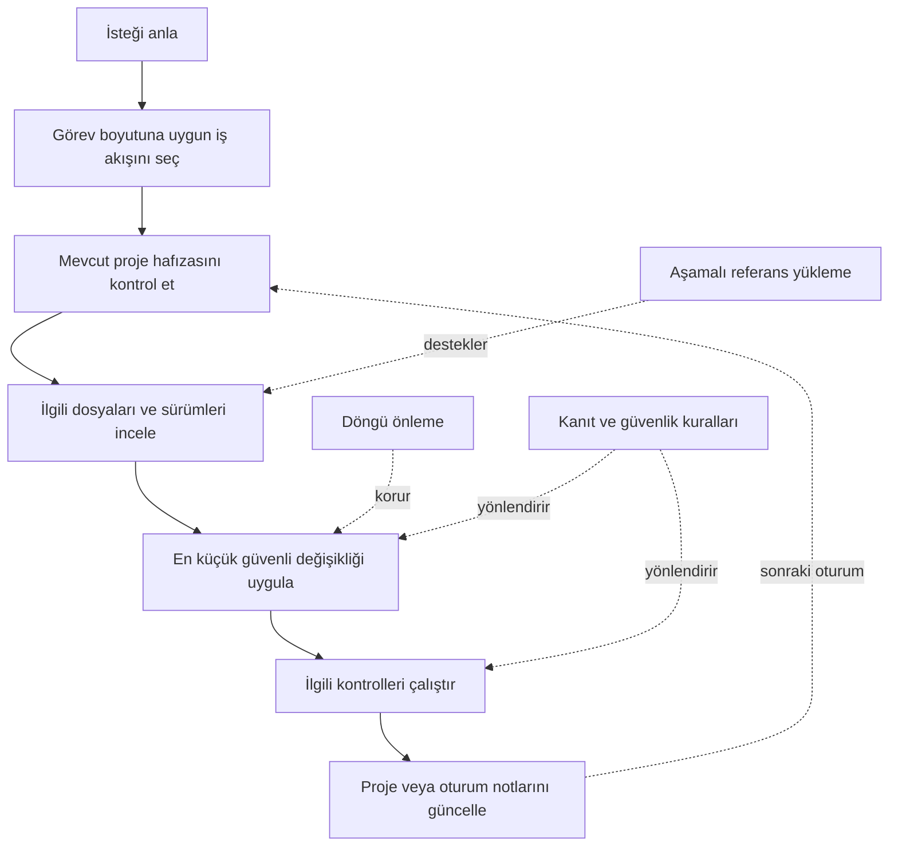

<div align="center">

# Conscious Workflow

### Claude için token bilincine sahip mühendislik iş akışı

**Daha az tekrar. Daha iyi bağlam. Kanıta dayalı geliştirme.**

<p>
  <a href="https://github.com/MrKroven/conscious-workflow/releases"></a>
  <a href="https://github.com/MrKroven/conscious-workflow/stargazers"></a>
  
  
  <a href="LICENSE"></a>
</p>

[Hızlı Başlangıç](#hızlı-başlangıç) · [Özellikler](#özellikler) · [Nasıl Çalışır?](#nasıl-çalışır) · [Kullanım Örnekleri](#kullanım-örnekleri) · [English](README.md)

</div>

---

## Conscious Workflow nedir?

**Conscious Workflow**, Claude'un yazılım geliştirme çalışmalarında daha disiplinli, bağlamı koruyan ve kanıta dayalı şekilde ilerlemesine yardımcı olan modüler bir Skill'dir. Proje inceleme, kodlama, hata ayıklama, teknik araştırma, refactoring ve çok aşamalı geliştirme görevleri için hazırlanmıştır.

Temel hedefi basit: **bağlamı aynı işleri tekrar ederek değil, gerçekten gerekli işler için kullanmak.**

Skill; kısa bir ana talimat seti kullanır ve ayrıntılı referans dosyalarını yalnızca ihtiyaç duyulan aşamada yüklemesi için Claude'u yönlendirir. İsteğe bağlı Python araçları proje haritası çıkarabilir, dosya anlık görüntülerini karşılaştırabilir, hafıza kayıtlarını tutabilir, tekrarlanan hataları izleyebilir ve Skill paketini doğrulayabilir.

İki kullanım biçimi vardır:

- **Claude Code:** Dosya sistemi üzerinden kurulur. `/conscious-workflow` komutuyla elle çağrılabilir veya uygun görevlerde otomatik seçilebilir.
- **Claude.ai:** Skill ZIP olarak yüklenir ve ayarlardan etkinleştirilir. Claude uygun görevlerde kullanabilir veya sen açıkça kullanmasını isteyebilirsin.

> [!IMPORTANT]
> Conscious Workflow yeni bir yapay zekâ modeli veya tamamen otonom çalışma garantisi değildir; Claude'a verilen bir talimat ve araç paketidir. Token kullanımı ve sonuç kalitesi modele, göreve, araçlara ve proje bağlamına göre değişir. Sabit bir token tasarrufu yüzdesi vaat edilmez.

## Neden Conscious Workflow?

| Problem | Conscious Workflow yaklaşımı |
|---|---|
| Aynı dosyaları tekrar tekrar okumak | Oturum notlarında kısa bulgular tutmak ve mümkün olduğunda yalnızca ilgili veya değişmiş dosyalara odaklanmak. |
| Başarısız komut veya düzeltmeyi tekrar denemek | Kök neden analizi yapmak, başarısız denemeleri kaydetmek ve körü körüne tekrar etmek yerine yöntemi değiştirmek. |
| Oturumlar arasında proje bağlamını kaybetmek | Kalıcı mimari notlarını aktif görev ve sonraki oturum devrinden ayrı tutmak. |
| Gereğinden fazla dokümanı baştan yüklemek | Aşamalı yükleme ile yalnızca görev için gereken referans dosyasını açmak. |
| API veya kütüphane davranışını tahmin etmek | Önce projedeki gerçek sürümleri kontrol etmek; ardından resmî dokümantasyon ve changelog kullanmak. |
| Kanıt olmadan işin tamamlandığını söylemek | İlgili kontrolleri çalıştırmak ve doğrulanmış sonuçları varsayımlardan ayırmak. |
| Küçük bir görev için gereksiz karmaşıklık oluşturmak | Planlama ve dokümantasyon seviyesini görevin büyüklüğüne göre ayarlamak. |

## Özellikler

### 1. Token bilincine sahip proje inceleme

Claude'dan dosyaları açmadan önce isteği anlaması, en küçük işe yarar bölümü incelemesi ve gerekçe olmadan değişmemiş dosyaları tekrar okumaması istenir. Büyük projelerde isteğe bağlı proje haritalayıcı kompakt bir dosya indeksi oluşturur ve SHA-256 tabanlı dosya anlık görüntüleri kaydeder.

Bu yaklaşım gereksiz bağlam kullanımını azaltmayı hedefler. Her görevde tam taramayı önlediği veya bütün token maliyetlerini ortadan kaldırdığı anlamına gelmez.

### 2. Döngü önleme ve kök neden hata ayıklama

Aynı hatanın tekrar etmesi durumunda üç aşamalı bir yaklaşım uygulanır:

| Deneme | Beklenen davranış |
|---|---|
| **1. hata** | Tam hata çıktısını al, ilgili kodu incele ve kök nedene yönelik bir hipotezi test et. |
| **2. hata** | Birbirine çok benzeyen düzeltmeleri durdur. Başarısız denemeyi kaydet ve belirgin şekilde farklı bir yöntem seç. |
| **3. hata** | Aynı başarısız işlemi tekrar etme. Olası nedeni, denenen yöntemleri ve kullanıcıdan gereken kararı veya eksik bilgiyi açıkla. |

İsteğe bağlı `memory_guard.py`, hata imzalarını kaydedebilir ve proje bazında kendi üç deneme sınırını uygulayabilir.

### 3. Kalıcı proje bağlamı

Çok oturumlu çalışmalar için iki temel hafıza dosyası kullanılır:

- `PROJECT_MEMORY.md` — teknoloji yığını, mimari, giriş noktaları, önemli dosyalar ve kalıcı teknik kararlar gibi nispeten sabit bilgiler.
- `SESSION_STATE.md` — aktif hedef, ilerleme, daha önce incelenen dosyalar, bilinen hatalar ve sonraki oturumda yapılacak ilk iş.

Büyük projelerde aşamaları ve kabul kriterlerini izlemek için isteğe bağlı `TASK_PROGRESS.md` şablonu da bulunur. Bunlar normal proje dosyalarıdır; kalıcı olmalarının nedeni gizli veya sınırsız bir AI hafızası değil, proje içinde saklanmalarıdır.

### 4. Araştırma ve kanıta dayalı mühendislik

Görev sürüme bağlı API'lere, bilinmeyen kütüphanelere veya değişebilen davranışlara bağlı olduğunda Skill; önce lockfile ve kurulu paket sürümlerini, ardından resmî dokümantasyon ve changelog kayıtlarını kontrol etmeyi önerir. Hedefli regresyon testlerini ve dürüst sonuç raporlamasını teşvik eder.

### 5. Göreve uygun çalışma yoğunluğu

Her görev uzun bir plan gerektirmez. İş akışı göreve göre ölçeklenir:

- **Küçük görev:** İsteği anla, odaklı değişikliği yap ve doğrula.
- **Standart görev:** İlgili dosyaları incele, uygula, hedefli kontrolleri çalıştır ve oturum notlarını güncelle.
- **Karmaşık görev:** Kapsam ve kabul kriterlerini belirle, projeyi haritala, aşamalı ilerle, doğrula ve sonraki oturum için devir notu bırak.

### 6. İsteğe bağlı Python araçları

Paket içindeki scriptler Skill'i kullanmak için zorunlu değildir. Python ve dosya sistemi erişimi bulunan yerel ortamlarda ek yardımcı araçlar olarak çalıştırılabilir.

## Nasıl çalışır?



### Aşamalı yüklenen referans modülleri

`SKILL.md` ana yönlendirici dosyadır. Her görevin başında tüm referans dosyalarını okuma talimatı vermez. Bunun yerine görev aşamasına uygun modülü seçer:

| Referans dosyası | Şu tür görevlerde yüklenir... |
|---|---|
| `references/project-analysis.md` | Yeni depo, arşiv, kod tabanı, doküman veya görsel proje incelemesi. |
| `references/memory-system.md` | Çok oturumlu projeye başlama, projeye geri dönme ve bağlamı koruma. |
| `references/token-optimization.md` | Büyük dosyalar, bağlam bütçesi ve verimli inceleme. |
| `references/loop-prevention.md` | Tekrarlanan hatalar, başarısız denemeler ve döngü kontrolü. |
| `references/debugging.md` | Kök neden analizi, test hataları ve regresyon doğrulaması. |
| `references/research-engine.md` | Bilinmeyen API'ler, kütüphane sürümleri, resmî doküman ve kullanımdan kaldırılan özellikler. |
| `references/software-engineering.md` | Üretim kodu yazma, refactoring ve kod incelemesi. |
| `references/task-execution.md` | Karmaşık planlama, yürütme aşamaları, otonomi sınırları ve görev devri. |

## Hızlı Başlangıç

Kullandığın ortama göre ilerle. **Slash komutu Claude Code içindir; Claude.ai kendi Skill arayüzünü kullanır.**

### Seçenek A — Claude Code (`/conscious-workflow` komutu)

#### 1. Genel kurulum

Genel kurulum, Skill'i tüm Claude Code projelerinde kullanılabilir hale getirir.

**Windows PowerShell**

```powershell
git clone https://github.com/MrKroven/conscious-workflow.git "$env:USERPROFILE\.claude\skills\conscious-workflow"
```

**macOS / Linux**

```bash
git clone https://github.com/MrKroven/conscious-workflow.git "$HOME/.claude/skills/conscious-workflow"
```

#### 2. Yalnızca tek projeye kurulum

Skill'i yalnızca bir projede kullanmak için proje ana dizininden Git submodule olarak ekleyebilirsin:

```bash
git submodule add https://github.com/MrKroven/conscious-workflow.git .claude/skills/conscious-workflow
```

Projeyi başka bir geliştirici klonladığında submodule'leri de indirmelidir:

```bash
git clone --recurse-submodules <your-project-repository>
```

Git submodule kullanmak istemiyorsan depo ZIP'ini indir ve `.git` klasörünü kopyalamadan içeriğini `.claude/skills/conscious-workflow/` dizinine taşı. Her iki yöntemde de `SKILL.md`, `conscious-workflow` klasörünün doğrudan içinde bulunmalıdır.

#### 3. Claude Code oturumunu yeniden başlat

Yeni Claude Code oturumunda şu komutu yaz:

```text
/skills
```

Listede `conscious-workflow` Skill'inin göründüğünü ve etkin olduğunu kontrol et.

#### 4. Skill'i çalıştır

Bu paketin klasör adı ve metadata adı `conscious-workflow` olduğu için Claude Code'daki doğrudan çağırma komutu:

```text
/conscious-workflow
```

Gerçek bir görev için komutu mesajın **en başına** yaz ve ardından isteğini belirt:

```text
/conscious-workflow Bu projeyi incele, mimarisini açıkla, giriş noktalarını belirle ve kısa bir proje haritası çıkar. Şimdilik hiçbir dosyayı değiştirme.
```

```text
/conscious-workflow Giriş yapma hatasının kök nedenini bul, en küçük güvenli düzeltmeyi uygula, ilgili testleri çalıştır ve gerçekten doğruladığın sonuçları raporla.
```

```text
/conscious-workflow Mevcut proje hafızasını kullanarak yarım kalan göreve devam et. Önce sonraki adım notunu incele ve tamamlanmış işleri tekrar yapma.
```

> [!TIP]
> İlgili bir kodlama veya mühendislik görevini normal şekilde de yazabilirsin; Claude Code Skill'i otomatik olarak seçebilir. Skill'in kesin olarak kullanılmasını istediğinde `/conscious-workflow` komutunu açıkça kullan.

**Komutun çalışma şekli:** `/conscious-workflow` Skill'in giriş komutudur; içinde ayrı ayrı tanımlanmış `debug`, `research` veya `implement` komutları yoktur. Slash komutundan sonra yazdığın kelimeler ayrı alt komut değil, Claude'a verdiğin görev açıklamasıdır.

### Seçenek B — Claude.ai (web veya masaüstü)

Claude.ai, Claude Code'daki `/conscious-workflow` slash komutunu kullanmaz. Bunun yerine Skill ZIP dosyasını yükleyip etkinleştir:

1. GitHub [Releases](https://github.com/MrKroven/conscious-workflow/releases) sayfasından `conscious-claude-en.zip` dosyasını indir.
2. Claude'da **Settings → Customize → Skills** bölümünü aç.
3. **Add / Create skill → Upload a skill** seçeneğini kullan. Arayüzdeki etiketler değişebilir.
4. ZIP dosyasını yükle ve **Conscious Workflow** Skill'ini etkinleştir.
5. Yardımcı scriptleri kullanmak istiyorsan, desteklenen ortamda **Code execution** özelliğinin açık olduğundan emin ol.
6. Yeni bir sohbet başlat ve Claude'dan görevin için Skill'i kullanmasını iste.

Örnek:

```text
Bu proje için Conscious Workflow Skill'ini kullan. Önce mevcut proje bağlamını incele, ardından yalnızca isteğimle ilgili dosyalara odaklan. Değişmemiş dosyaları gereksiz yere tekrar okuma, başarısız bir yöntemi körü körüne tekrarlama ve kod değişikliklerini tamamlandı demeden önce doğrula.
```

Claude.ai etkinleştirilmiş Skill'leri uygun olduğunda otomatik seçebilir. Mesajında Skill'in adını açıkça belirterek de kullanmasını isteyebilirsin. Claude.ai'de `/conscious-workflow` yazınca Claude Code'daki slash komutunun çalışmasını bekleme.

## Kullanım örnekleri

Aşağıdakiler ayrı slash komutları değil, görev örnekleridir. Claude Code'da açıkça çağırmak için başına `/conscious-workflow` ekle. Claude.ai'de Skill etkinleştirildikten sonra normal mesaj olarak gönder.

| Hedef | Örnek istek |
|---|---|
| Projeyi tanımak | "Projeyi haritala, teknoloji yığınını ve giriş noktalarını belirle, ana modüllerin nasıl bağlandığını açıkla. Hiçbir dosyayı düzenleme." |
| Hata düzeltmek | "Hatayı yeniden üret, kök nedenini bul, en küçük güvenli düzeltmeyi yap ve hedefli regresyon kontrolü çalıştır." |
| Özellik eklemek | "Önce mevcut mimariyi incele. Bu özelliği mevcut kalıplara uygun geliştir ve ilgili testleri güncelle." |
| API araştırmak | "API seçmeden önce kurulu paket sürümünü ve resmî dokümantasyonu kontrol et. Doğrulayamadığın noktaları açıkça belirt." |
| Çalışmaya devam etmek | "Önce proje hafızasını ve oturum devrini oku. Tamamlanmış işleri tekrarlamadan kayıtlı sonraki adımdan devam et." |
| Kod incelemek | "Değişen dosyaları doğruluk, uç durumlar, güvenlik ve eksik testler açısından incele. Bulguları dosya referanslarıyla raporla." |

## İsteğe bağlı komut satırı araçları

Paket içindeki scriptler için **Python 3.8 veya üzeri** gerekir. Scriptler Skill klasöründe bulunur. Aşağıdaki örnekler, Skill'in hedef projenin içinde `.claude/skills/conscious-workflow/` yoluna kurulduğunu varsayar. Genel kurulum yaptıysan bu yolu `~/.claude/skills/conscious-workflow/` olarak değiştir.

Komutları hedef projenin ana dizininde çalıştır.

### `project_mapper.py` — proje haritası ve dosya anlık görüntüsü

Kısa proje haritası çıkar ve SHA-256 anlık görüntüsünü kaydet:

```bash
python .claude/skills/conscious-workflow/scripts/project_mapper.py . --save-cache
```

Projeyi önceki anlık görüntüyle karşılaştır:

```bash
python .claude/skills/conscious-workflow/scripts/project_mapper.py . --diff
```

Anlık görüntü hedef projede `.claude/memory/.file_cache.json` konumunda tutulur. `--diff`, son kaydedilmiş anlık görüntüye göre eklenen, değişen, silinen ve değişmemiş dosyaları raporlar. İlk karşılaştırmadan önce `--save-cache` ile başlangıç kaydı oluştur.

Diğer seçenekler:

```bash
python .claude/skills/conscious-workflow/scripts/project_mapper.py . --max-files 100
python .claude/skills/conscious-workflow/scripts/project_mapper.py ../another-project --save-cache
```

### `memory_guard.py` — hafıza kurulumu ve döngü takibi

Hafıza klasörünü ve başlangıç dosyalarını oluştur:

```bash
python .claude/skills/conscious-workflow/scripts/memory_guard.py init --root .
```

Bir dosyayı inceledikten sonra kısa özetini önbelleğe ekle:

```bash
python .claude/skills/conscious-workflow/scripts/memory_guard.py check-file src/app.py --summary "Uygulama giriş noktası ve başlatma akışı" --root .
```

Daha sonraki kontrolde `--summary` parametresini kaldır. Dosya değişmediyse önbellek sonucu döner:

```bash
python .claude/skills/conscious-workflow/scripts/memory_guard.py check-file src/app.py --root .
```

Hata imzasını ve denenen çözümü kaydet:

```bash
python .claude/skills/conscious-workflow/scripts/memory_guard.py log-error "TypeError:auth.py:42" "Servis çağrısından önce istek verisi doğrulandı" --root .
```

Guard durumu `.claude/memory/.guard_state.json` içinde saklanır. `log-error` aracı aynı hata imzası üçüncü kez kaydedildiğinde sıfırdan farklı çıkış koduyla durur. Aynı temel hata için tutarlı bir imza kullan; farklı imzalar ayrı sayaçlar oluşturur.

### `validate_skill.py` — paket doğrulama

```bash
python .claude/skills/conscious-workflow/scripts/validate_skill.py
```

Gerekli Skill metadata'sını, referans verilen yerel dosya yollarını ve Python sözdizimini kontrol eder. Bu, paketin temel doğrulamasıdır; Claude'un gerçek görevlerdeki davranışını test etmenin yerini tutmaz.

> [!NOTE]
> Bazı sistemlerde `python` yerine `python3` kullanmalısın. Windows'ta `python` PATH üzerinde değilse `py -3` komutunu deneyebilirsin.

## Depo yapısı

```text
conscious-workflow/
├── SKILL.md                    # Ana talimatlar ve aşamalı yükleme yönlendiricisi
├── CLAUDE.md                   # Projenin kök CLAUDE.md dosyasına aktarılabilecek şablon
├── INSTALL.md                  # Kurulum ve kullanım rehberi
├── README.md                   # İngilizce dokümantasyon
├── README_TR.md                # Türkçe dokümantasyon
├── LICENSE                     # MIT lisansı
├── references/                 # İhtiyaç olduğunda yüklenen ayrıntılı talimatlar
│   ├── debugging.md
│   ├── loop-prevention.md
│   ├── memory-system.md
│   ├── project-analysis.md
│   ├── research-engine.md
│   ├── software-engineering.md
│   ├── task-execution.md
│   └── token-optimization.md
├── scripts/                    # İsteğe bağlı Python yardımcıları
│   ├── memory_guard.py
│   ├── project_mapper.py
│   └── validate_skill.py
└── templates/                  # Tekrar kullanılabilir hafıza şablonları
    ├── PROJECT_MEMORY.md
    ├── SESSION_STATE.md
    └── TASK_PROGRESS.md
```

## Güvenlik ve sınırlar

- **Sabit token tasarrufu iddiası yok:** Tasarruf; görev boyutuna, araç erişimine, proje yapısına ve model davranışına göre değişir.
- **Otonomi garantisi yok:** Claude, çalıştığı ortamın izin ve yetenekleri dahilinde hareket eder.
- **Mühendislik kontrolleri atlanmaz:** Token verimliliği doğruluk, güvenlik veya gerekli testlerin önüne geçmemelidir.
- **Yıkıcı işlemlerde onay:** Skill; dosya/veri silme, yıkıcı Git komutları veya harici/üretim sistemlerini ve kimlik bilgilerini değiştirme öncesinde açık onay ister.
- **Yerel dosyalar hafıza katmanıdır:** Proje hafızası ve anlık görüntüler `.claude/memory/` altında saklanır. Bunları projenin ihtiyacına göre yedekle veya sürüm kontrolüne al. Paylaşmadan önce oluşan notları kontrol et.
- **Yüklemeden önce incele:** Tanımadığın kaynaklardan gelen Skill ve scriptleri çalıştırmadan önce gözden geçir.

## Sorun giderme

| Sorun | Kontrol etmen gerekenler |
|---|---|
| Claude Code'da `/conscious-workflow` görünmüyor | `SKILL.md` dosyasının `.claude/skills/conscious-workflow/SKILL.md` veya `~/.claude/skills/conscious-workflow/SKILL.md` konumunda olduğunu doğrula. Yeni oturum aç ve `/skills` listesini kontrol et. |
| Claude Code Skill'i buluyor ama otomatik seçmiyor | `/conscious-workflow` ile açıkça çağır. Skill'in `/skills` menüsünde veya ayarlarda gizlenmediğini kontrol et. |
| Claude.ai'de slash komutu çalışmıyor | Bu beklenen davranıştır. Skill'i Claude.ai ayarlarından yükleyip etkinleştir, ardından doğal dille kullanmasını iste. |
| Yardımcı script çalışmıyor | Python 3.8+ kurulu mu, komutu doğru dizinde mi çalıştırıyorsun ve dosya sistemi izinleri var mı kontrol et. |
| Dosya önbelleği güncel görünmüyor | Yeni başlangıç kaydı için `project_mapper.py . --save-cache`, sonraki karşılaştırmalar için `--diff` çalıştır. |
| Hafıza dosyaları yok | Proje kök dizininde `python .claude/skills/conscious-workflow/scripts/memory_guard.py init --root .` komutunu çalıştır (genel kurulumda Skill yolunu değiştir). |

## Katkıda bulunma

Issue, hata bildirimi ve geliştirme önerileri memnuniyetle karşılanır. Sorun bildirirken şu bilgileri ekle:

1. Kullanılan ortam (Claude Code veya Claude.ai) ve işletim sistemi.
2. İlgili Skill sürümü veya commit bilgisi.
3. Kullanılan tam prompt veya komut.
4. Gözlenen davranış ve beklenen davranış.
5. Gizli anahtarlar ve kişisel veriler çıkarılmış hata çıktısı.

Skill'i geliştirirken `SKILL.md` dosyasını odaklı tut; yalnızca belirli görev türlerinde gereken ayrıntıları referans modülüne taşı. Değişiklik göndermeden önce doğrulayıcıyı çalıştır:

```bash
python scripts/validate_skill.py
```

## Resmî dokümantasyon

- [Claude Code — Skills](https://code.claude.com/docs/en/skills)
- [Claude Help Center — Skills kullanımı](https://support.claude.com/en/articles/12512180-use-skills-in-claude)
- [Claude Help Center — Özel Skill oluşturma](https://support.claude.com/en/articles/12512198-how-to-create-custom-skills)
- [GitHub — Markdown yazım ve biçimlendirme](https://docs.github.com/en/get-started/writing-on-github/getting-started-with-writing-and-formatting-on-github/basic-writing-and-formatting-syntax)

---

<div align="center">

**Odaklı çalışma için üretildi. Gereksiz bağlam tüketimini azaltmak için tasarlandı.**

<sub>Conscious Workflow · Açık kaynak · Katkı ve hata bildirimlerine açıktır.</sub>

</div>
